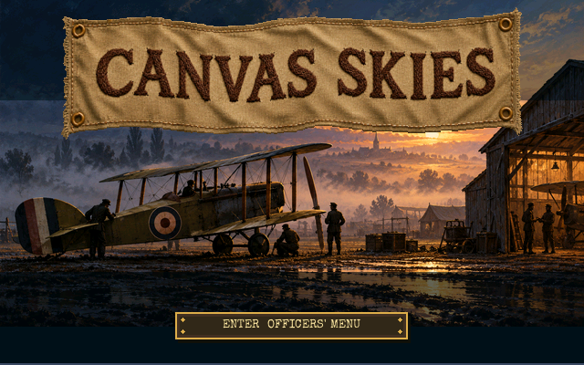
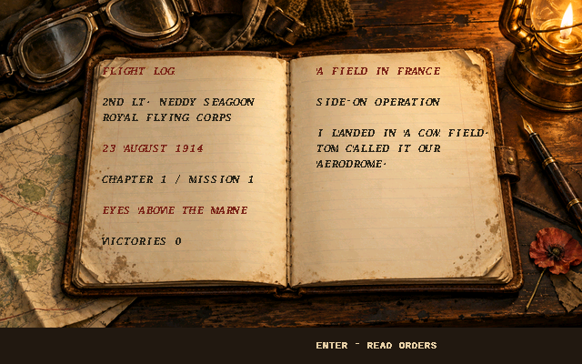
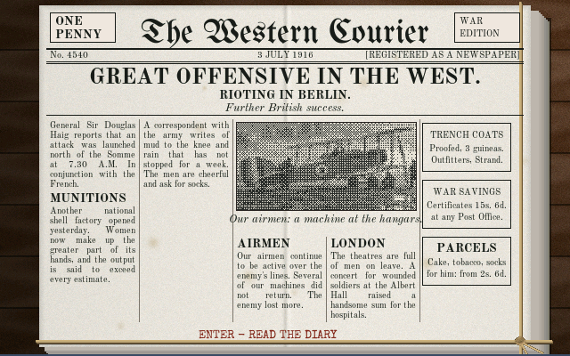
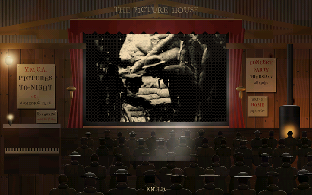
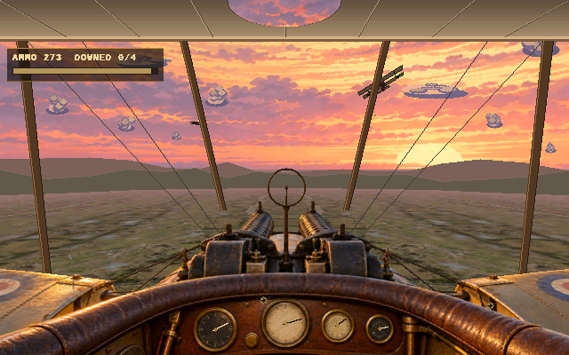
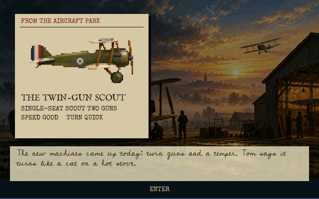
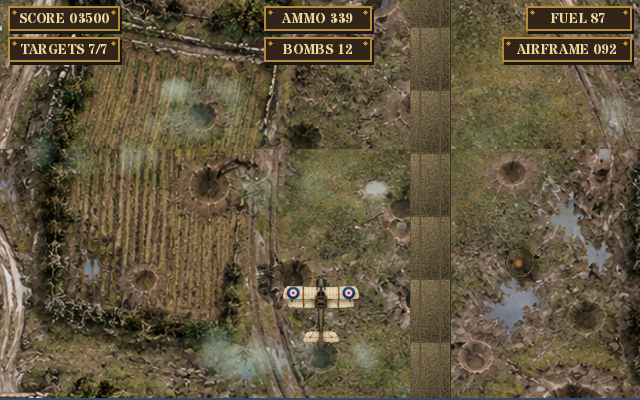
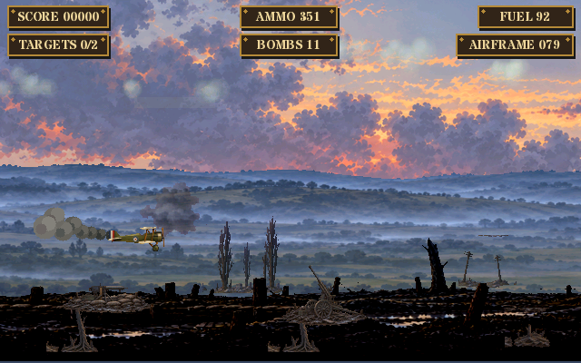
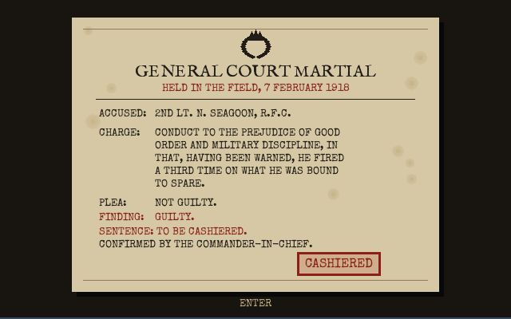

# Canvas Skies

Canvas Skies is an original First World War flying game for AmigaOS 3. You
follow pilot Neddy Seagoon of the Royal Flying Corps through an eight-chapter,
96-mission campaign, from observation flights in August 1914 to 11:00 on
Armistice Day.

It grew out of the Sopwith porting work in
[amigasdlsopwith](https://github.com/DalsinAI/amigasdlsopwith), but it is a new
game: no SDL Sopwith code is used.

Current release: **0.2.0 RC6**, a release candidate. Download it from
[the v0.2.0-rc6 release](https://github.com/DalsinAI/canvasskies/releases/tag/v0.2.0-rc6).

New in RC6:

- **Christmas truce:** flown in full, out over men of both armies meeting in no
  man's land, the pudding dropped, and home to land.
- **1914 cockpit:** Tom's observer's work: mark a column, drop a message bag (B),
  photograph a battery and signal the fall of our guns' shells (S).
- **Lewis gun:** depresses to 30 degrees below level, with attackers from below.
- **Squalls:** in the cockpit and the rear seat too, with a rain haze inside.
- **The mess:** the officers painted as men by lamplight, each evening told by
  what they are doing.
- **Wingmen and grounding:** wingmen carry their wounds; a grounding survives a
  quit.
- **We Remember:** a roll call over the old front at the end of the game.
- **Campaign:** four side-on, four top-down, two dogfight and two rear-seat
  sorties a chapter, with orders a careful pilot can meet.
- **Aerodrome films:** the 1914 climb, the flight of three in frame, and a muddy
  field that reads as mud.

New in RC5:

- **Missions:** something to do all the way:
  - Archie, ground machine guns, riflemen taking pot shots, kite balloons and
    squalls;
  - 1914's work of marking columns, dropping message bags and photographing
    batteries;
  - a run home to land at the aerodrome.
- **Aerodrome films:** take-offs and landings on old film, with their own
  sound, before and after each sortie.
- **1914 rear seat:** the observer's carbine swings right round the tail, and
  attackers come from the flanks and break off when hit.
- **The mess:** three evenings (quiet, rowdy, and a wake after a loss) with the
  squadron by lamplight.
- **The Officer's Preferences:** keep the art in memory, music and effects
  volume, full screen.
- **Memory:** about 25 MB of fast memory instead of 63, as each scene loads only
  its own art.
- **Workbench:** returned intact after full screen.

The earlier alpha is described in
[docs/ALPHA_RELEASE_NOTES.md](docs/ALPHA_RELEASE_NOTES.md).

## Features

- Side-on, top-down, cockpit dogfight and rear-gunner sorties
- The cockpit from the pilot's seat: the top wing overhead, the struts beside
  the gun, the world banking around the machine
- Machines that change with the war, ours and theirs: a 1914 two-seater
  armed with a rifle and revolver, a single-Vickers scout, a twin-gun scout
  and a late-war scout, against the Fokker monoplane, the Albatros and the
  late Fokker
- Top-down raids built from the war's targets: lorry convoys, trains and
  stations, aerodromes, depots and trench runs, mixed to suit each year
- Ambulances, villages and our own line to spare: a reprimand, a lost rank,
  then a court martial that ends the career
- Bombs that burst too close hurt your own machine
- Pilot's diary and General Headquarters orders before every sortie, and a
  career of victories, promotion and medals
- The morning paper on its tied bundle, quoting real cable news of
  1914-1918, and the Book of Press Cuttings
- The picture house behind the lines, showing real film of each year
- Three-life campaign with field hospital recovery and a graveside memorial
- Resumable campaign saves
- Period typefaces, painted art and period gramophone records
- F9 toggles aspect-correct fullscreen
- Take-offs and landings on old film, and the mess in three moods
- The Officer's Preferences: art kept in memory or loaded as needed, music and
  effects volume

## Screenshots

Captured from the 68040 Amiga build running on AmigaOS with GFOpenUp, at the
game's own 640x400.

| | |
|---|---|
|  |  |
| The title screen | Neddy Seagoon's flight log, ruled and written in his hand |
|  |  |
| The morning paper on its bundle | The picture house behind the lines, showing real film of 1916 |
|  |  |
| A 1916 patrol from the pilot's seat, one Vickers under the sight | New machines from the aircraft park |
|  |  |
| A top-down raid on a convoy and its depot | A side-on sortie at dusk |
|  | |
| Fire on civilians three times and it ends here | |

## Requirements

- AmigaOS 3.x on a 68040 with FPU (or an AmiCradle instance)
- RTG graphics: the game opens a 640x400 window on a 16-bit (or deeper)
  Workbench screen
- GFOpenUp's GFOpenGPU part, with its SDL 2 runtime
  (`LIBS:GFOpenGPU/SDL2.module` and `LIBS:gfopengpu.library`), tested with
  GFOpenUp 0.8.26. Without it the game stops at once and says so.
- AHI for sound

## Building

Cross-compile with the GFOpenAmigaGCC `os32-gcc16` stove:

```sh
make -f ports/amigaos3/Makefile.canvas -j2
```

Set `AMIGA_STOVE` if your stove is not at `~/AmiCradle/stoves/os32-gcc16`.
The binary is `build-canvas-skies/CanvasSkies`. It loads its art and sound
from `PROGDIR:assets/canvas-skies/`, so keep the `assets` drawer beside it.

`make -f ports/amigaos3/Makefile.canvas package` builds a release drawer in
`build-canvas-skies/package/` holding the executable, icons, licences and only
the assets the game loads, without the source PNGs.

## Controls

| Context | Controls |
|---|---|
| Menus | Up/Down select, Enter accepts, Escape returns |
| Side/top-down | Arrow keys move, X/Z adjust speed, Space fires (a rifle in 1914), B bombs |
| Pilot dogfight | Left/Right bank, Down pulls up, Up pushes down, X/Z throttle, Space fires (a revolver in 1914), R clears a jam, H turns for home |
| Rear gunner | Arrow keys traverse/elevate, Space fires |
| 1914 observer's work | B drops the message bag, S signals the fall of our guns' shells (cockpit), hold steady over a battery to photograph it |
| Display | F9 toggles fullscreen |

## Documentation

- [Overview](CANVAS_SKIES.md)
- [Story and design](docs/CANVAS_SKIES_STORY_AND_DESIGN.md)
- [Implementation status](docs/CANVAS_SKIES_STATUS.md)
- [Delivery vision](CANVAS_SKIES_DELIVERY_VISION.md)
- [Historical sources](CANVAS_SKIES_SOURCES.md)

## We Remember

At the very end of the game, after the Armistice, the camera drifts across
the old front in the summer of 1919, the trenches grassed over and the
poppies grown up through the wire, with nothing but the wind. Over it, under
the words **WE REMEMBER**, a roll of names is shown.

Those names are given by people who have given to the
[Royal British Legion](https://www.britishlegion.org.uk/get-involved/donate),
in memory of someone of theirs who served.

**To give:** please give directly on the Legion's own site,
<https://www.britishlegion.org.uk/get-involved/donate>. The game is free;
we never see or handle any money, and we do not ask how much you gave.

**To add a name:** after giving, either
[open a We Remember request](https://github.com/DalsinAI/canvasskies/issues/new?template=we-remember.yml)
or, without a GitHub account, email
[amigachrome@gmail.com](mailto:amigachrome@gmail.com?subject=We%20Remember)
with the rank, name, unit and years of the person to be remembered (rank,
unit and years are optional), saying that you have given to the Legion and
that you consent to the name being shown in the game and this repository.
Names are shown as `Rank. Name, Unit, Year`. Names are added in the next release, in `WeRemember.txt` in the
`CanvasSkies` drawer, which the game reads (in this repository it is
`ports/amigaos3/package/WeRemember.txt`). Only the name to be
remembered is shown, never yours, and no email addresses or amounts are kept
in the game or this repository.

**To remove a name:** open an issue or email amigachrome@gmail.com asking
for it to be taken off,
and it will be removed in the next release.

## Licence

Canvas Skies is free software under the
[GNU General Public License, version 3](LICENSE). Music, font, film and art
licences are listed below.

## Credits

Designed, tested and delivered by The AmiCradle Team.

Music, font, film and art credits are in
[assets/canvas-skies/MUSIC_LICENSE.md](assets/canvas-skies/MUSIC_LICENSE.md),
[assets/canvas-skies/ART_PROVENANCE.md](assets/canvas-skies/ART_PROVENANCE.md),
[CANVAS_SKIES_SOURCES.md](CANVAS_SKIES_SOURCES.md) (the newsreels and
typefaces) and the font licences in `assets/fonts/`.

Neddy Seagoon, Eccles, Bluebottle and Gridpipe Thyne are an affectionate nod
to *The Goon Show*.
